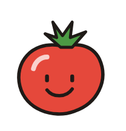
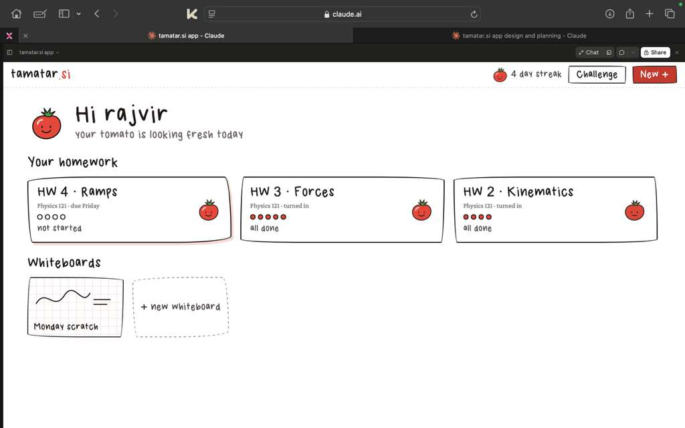
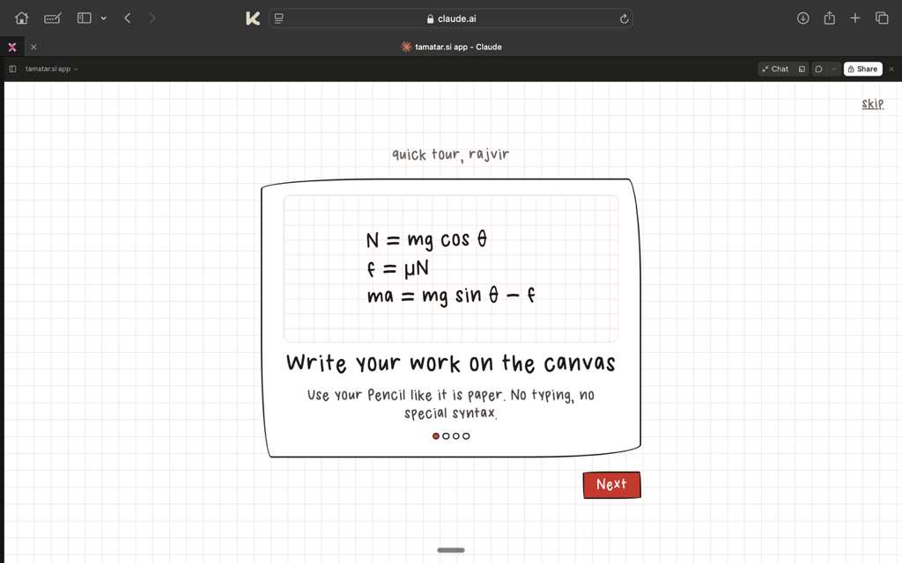

<div align="center">



# tamatar.si

### A red pen tutor for handwritten physics.

Write naturally. Find the first mistake. Keep learning.

**DubHacks 2026 · University of Washington · October 17–18**

[The idea](#the-idea) · [Features](#features) · [How it works](#how-it-works) · [Run locally](#run-locally) · [Project docs](#project-docs)

</div>

---

## The idea

You fill a page with arrows, equations, and crossed-out calculations. The answer key tells you that you're wrong. It doesn't tell you where your reasoning went off track.

**tamatar brings a teaching assistant's red pen to your own handwriting.** Draw a free-body diagram and solve a physics problem on an iPad. Press **Check**, and the tutor looks for the first incorrect step, circles the relevant ink, and offers just as much help as you want.

Start with a mark. Reveal a hint. Ask for an explanation. See the full answer when you're ready.

*Tamatar means “tomato” in Hindi.* Your tomato companion bruises when you repeat a mistake and perks up as you improve—a playful reason to try again.

## A look at the demo



*A notebook-inspired home for homework, scratch work, and a tomato that grows with you.*

<details>
<summary><strong>See the handwriting-first onboarding</strong></summary>

<br>



*Use your Pencil like paper. No typing, no special syntax.*

</details>

These screenshots show the earlier interactive artifact prototype; the current Next.js app includes the features below.

## Features

### Handwriting and red-pen feedback

- **Apple Pencil and mouse input.** Pressure-sensitive ink, pen and pencil tools, a straight-line ruler, eraser, ink colors, and three stroke widths. Fingers and palms do not draw; two-finger taps undo and three-finger taps redo.
- **Check the diagram and the equations.** Problems with a free-body diagram use separate writing surfaces. Once the diagram is checked, it stays available as a tappable thumbnail on the equations board. Other problems open directly on a solution board.
- **Find the first mistake.** Feedback places a red circle, a short correction, and a connector near the relevant work. Writing again marks the feedback as stale so you can check the revised work.
- **Mark → Hint → Explain → Answer.** All help levels arrive with the check response, so revealing more help does not require another model request. Hint usage is tallied.
- **Circle-to-check.** Drawing a closed loop offers **Check this?** to request a final-answer check.
- **iPad layouts in both orientations.** The board fits the available viewport and preserves ink during rotation. Homework opens as a drawer on iPad; portrait mode moves the help and action controls below the workspace. Yellow feedback notes sit on the writing area, with voice controls above their scrollable text.

### Worksheets, planning, and saved work

- **23 built-in problems across five Physics 121 worksheets:** ramps (5), energy and momentum (5), circles, gravity and rotation (5), Newton's laws (4), and kinematics (4). Each problem includes reference reasoning and a worked answer.
- **Upload your own worksheet.** Import a PDF, PNG, or JPEG, review the extracted problems, choose which to include, and set a due date. Figures are cropped from the upload and kept with their problems. Uploads must be under 3 MB; PDFs are limited to 10 pages.
- **Homework progress.** Cards, progress bars, and diagram/solution completion states show where you left off. Work autosaves, with a **Save progress** action for an immediate save.
- **Calendar and due dates.** A monthly calendar and upcoming list link back to assignments. Uploaded worksheets let you add or change their due dates from the homework page or calendar. Navigation highlights when unfinished work is due today or overdue.
- **Accounts and cloud saves.** Optional Supabase email/password accounts sync uploaded worksheets, worksheet figures, problem ink, and completion progress. Onboarding collects an email, US phone number, school, and browser timezone. Without Supabase, work stays in local browser storage. Scratch whiteboards remain local to the browser.
- **PDF export.** Once every problem is complete, export the worksheet's questions, figures, diagrams, handwritten solutions, and checked labels as a PDF.
- **Scratch whiteboards.** Create a blank board from **New +** and check physics or math without an assigned worksheet.

### Tools and companion

- **Spoken notes.** ElevenLabs reads the revealed hint or explanation. **Listen**, **pause**, **resume**, and **start again** control playback; **read new notes aloud** toggles automatic reading. Replaying the same note reuses its generated audio. Changing problems or closing help stops playback.
- **Scientific calculator.** An offline calculator with degree/radian modes, trigonometry and inverse functions, powers, roots, logarithms, constants, and the previous answer.
- **Tomato companion.** Animated reactions respond to mistakes and successful checks. The interface uses graph paper, wobbly borders, sticky notes, and our **Myfont** handwriting font with math and physics symbols.
- **Tutorial and warm-up.** A guided tour and practice writing surface introduce the handwriting workflow.

**Current limits:** the **Challenge / Race a friend** interface uses a simulated leaderboard. Supabase race helpers and schema exist, but the UI is not wired to live multiplayer. Database migrations also provide opt-in messaging fields and reminder bookkeeping; sending reminders requires a separate bot, which is not included here. Changing a worksheet's due date resets its reminder-sent state for that integration.

## How it works

```text
Apple Pencil / mouse → SVG ink → PNG → /api/check
                                            ↓
                          Claude vision + server-owned reference
                                            ↓
                          validated feedback + error coordinates
                                            ↓
                          red circle + mark / hint / explanation
                                            ↓
                             optional /api/speak → ElevenLabs

PDF / worksheet photo → /api/extract → selected problems + cropped figures
                                            ↓
                              local storage or Supabase account
```

The browser sends the work image and problem ID. The backend supplies the built-in reference solution or verifies a signed problem token for an imported worksheet, then validates the model's feedback and normalized error bounding box. Requests have deadlines, cancellation, and at most one retry for retryable failures. Provider keys stay on the server.

**Stack:** Next.js 14 · React 18 · TypeScript · Tailwind CSS · Pointer Events and SVG · perfect-freehand · Anthropic SDK · ElevenLabs · Supabase Auth/Postgres/Storage · Math.js · PDF.js · jsPDF.

The model aliases currently configured in [lib/ai/checker.ts](lib/ai/checker.ts) are `sonnet` → `claude-sonnet-5-5` and `haiku` → `claude-haiku-5-5`. Both checking and extraction default to `sonnet`; each route can be configured independently.

## Run locally

Node.js 22 or newer is recommended. Install dependencies and create your local configuration:

```bash
git clone https://github.com/saiompatro/tamatar_dubhacks.git
cd tamatar_dubhacks
npm ci
cp .env.example .env.local
```

Set `ANTHROPIC_API_KEY` in `.env.local` to enable real checks and worksheet extraction. Optional configuration is documented in [.env.example](.env.example):

- `AI_CHECK_MODEL` / `AI_EXTRACT_MODEL`: `sonnet`, `haiku`, or a full Claude model ID.
- `AI_EFFORT` / `AI_TIMEOUT_MS`: reasoning effort and the overall checking deadline. Extraction has a minimum 45-second server deadline.
- `ELEVENLABS_API_KEY`: enables spoken feedback. `ELEVENLABS_VOICE_ID` and `ELEVENLABS_MODEL_ID` customize the voice; the configured default voice is Roger.
- `PROBLEM_SIGNING_SECRET`: a stable secret for imported problem tokens. If omitted, signing falls back to the provider key; rotating the signing key requires reimporting affected worksheets.
- `NEXT_PUBLIC_MOCK=1`: enables explicitly labeled simulated check feedback without a Claude call. Worksheet extraction still requires the backend and its provider key. Voice has its own ElevenLabs configuration.

Then start the app:

```bash
npm run dev
```

Open [localhost:3000](http://localhost:3000), complete the welcome flow, and choose a built-in worksheet. Use **New + → Upload worksheet** to import a PDF or photo, or **New + → Blank whiteboard** for scratch work. If your browser blocks voice autoplay, tap **listen** on the yellow note.

### Optional accounts and cloud storage

Leave `NEXT_PUBLIC_SUPABASE_URL` and `NEXT_PUBLIC_SUPABASE_PUBLISHABLE_KEY` blank for browser-local use. To enable accounts:

1. Apply the SQL files in [supabase/migrations](supabase/migrations) to your Supabase project in filename order. They define races, account worksheets and work, private figure storage, profiles, due dates, and reminder rescheduling.
2. Enable email/password authentication and allow the app's `/login` URL as an auth redirect. If email confirmation is enabled, new users must confirm before continuing.
3. Set the two public Supabase variables in `.env.local`, then restart the dev server.

Use only the publishable key in the browser. Provider credentials and Supabase secret/service-role keys must never use `NEXT_PUBLIC_` variables. The migrations include row-level policies for each user's worksheets, work, profiles, and stored figures.

### Checks and evaluation

```bash
npm run typecheck
npm run lint
npm run test:tools
npm run test:voice
npm run build
```

`test:tools` covers drawing geometry, ink rendering and serialization, and calculator expressions; `test:voice` covers speech validation, provider responses, playback, caching, and cancellation. For a basic server health check:

```bash
curl http://localhost:3000/api/health
# {"ok":true}
```

The [evaluation harness](scripts/eval/README.md) generates synthetic handwriting and free-body diagrams and measures checking accuracy, error localization, and latency. Its results are synthetic; real student handwriting and physical iPad Safari still need broader evaluation.

## What's next

Validate the complete solving, worksheet import, voice, and orientation-change flows on physical iPads; evaluate feedback on real student handwriting; connect the multiplayer UI to the existing race backend; and integrate the opt-in reminder bot.

We're also exploring our own handwriting recognizer using symbol and expression datasets. The longer-term path separates reading ink from checking physics: a custom recognizer supplies structured math, while diagram geometry and reasoning checks identify the mistake. This is research in progress; no custom trained model is claimed in this submission.

## Project docs

- [Project context](planning/product/context.md) — scope, shared contracts, and the original demo story.
- [Design plans](planning/design/ui_planning.md) and [delight spec](planning/design/delight.md) — the notebook interface, tomato, motion, and sound.
- [Backend and hosting](planning/backend/backend_planning.md) — architecture and deployment plan.
- [AI model comparison](planning/ai/api_planning.md) — candidates and evaluation criteria.
- [Handwriting datasets](planning/ai/handwriting-datasets.md) and [dataset strategy](planning/ai/dataset_strategy.md) — data sources and research direction.
- [Evaluation harness](scripts/eval/README.md) — reproducible synthetic checks and known limitations.
- [Team responsibilities](planning/team/split.md) · [Full planning index](planning/README.md).

---

<div align="center">

**Built by a team of three at DubHacks 2026.**

*A little red ink. A clearer next step. A fresher tomato.*

</div>
